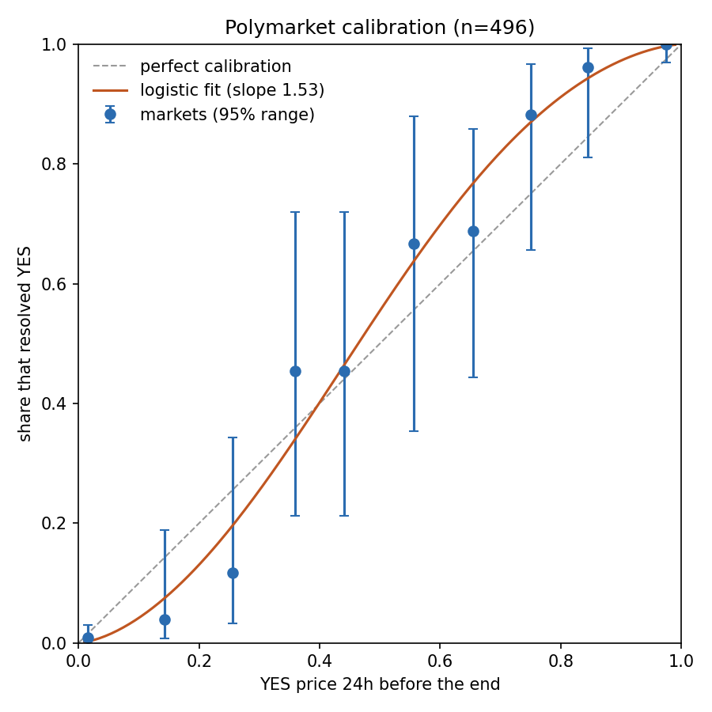

# Prediction-market research toolkit

Two small studies on public Polymarket and Kalshi data (no API keys needed):

1. **Calibration.** Are prediction-market prices honest probabilities? For resolved binary Polymarket markets, it takes the YES price a fixed time before each market ended and compares it with the outcome:
   - a calibration table with 95% ranges, and a chart
   - the Brier score (lower = better forecasts)
   - a logistic fit of outcome on logit(price) to test for **favourite-longshot bias**. A slope above 1 means longshots are overpriced and favourites underpriced.
2. **Executable fair value.** The mid price is not what you can trade at. For live order books it walks the book for a $100 and $1,000 trade, adds fees (Kalshi's published taker-fee formula), and reports the real buy price, sell price and round-trip cost. A model's probability has to beat that cost before a trade has an edge.

## Run

```
pip install requests numpy matplotlib
python predictions.py fetch --n 400        # resolved markets + price 24h before the end (resumable)
python predictions.py analyze              # calibration table, Brier score, bias test, calibration.png
python predictions.py fairvalue --top 10   # live Polymarket books ( --kalshi TICKER ... for Kalshi )
```

Options: `--hours-before 72` for a different horizon, `--min-volume 50000` for more liquid markets.

## Results

Run on 6 Nov 2026: **496 resolved binary Polymarket markets** ($10k+ volume), YES price 24 hours before the end.

**There is a significant favourite-longshot bias.** The logistic slope is **1.53 ± 0.34** (1.0 = perfectly calibrated). On the 133 uncertain markets (priced 10–90%), it is **1.64 ± 0.51**.

| YES price 24h before | Markets | Avg price | Resolved YES |
| --- | --- | --- | --- |
| 10–20% | 26 | 14.3% | 3.8% |
| 20–30% | 17 | 25.5% | 11.8% |
| 70–80% | 17 | 75.0% | 88.2% |
| 80–90% | 26 | 84.6% | 96.2% |

The overall Brier score is 0.041 (base rate: 0.237), but 73% of markets were already priced under 10% or over 90%. On the uncertain markets alone it is 0.136.



**Costs decide which side is tradeable.** Live order books (6 Nov 2026) showed round trips costing about **1–3% of the price** in liquid contracts (Fed decisions, Netanyahu) but **33–84%** for 1–2 cent longshots. The bias can only be harvested from the favourite side, and only after the checks below.

## Limitations

- One price per market at a fixed horizon. "End" is Polymarket's listed end or close time, not always the exact moment the outcome was known.
- Markets on the same event are not independent, so the confidence ranges are optimistic.
- The calibration study ignores spread and fees. The `fairvalue` command shows how large those costs are.
- Polymarket fees are assumed to be zero. Some market types charge fees, so check before trading.

## Next steps

- Calibration by category (politics, sports, crypto) and by horizon (1 hour, 1 day, 1 week before the end).
- Match the same event across Kalshi and Polymarket after aligning fees and settlement rules, then measure how often the price gap exceeds the round-trip cost.
